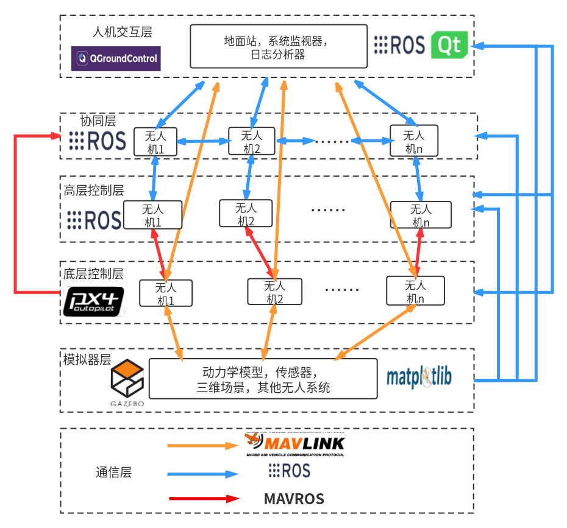
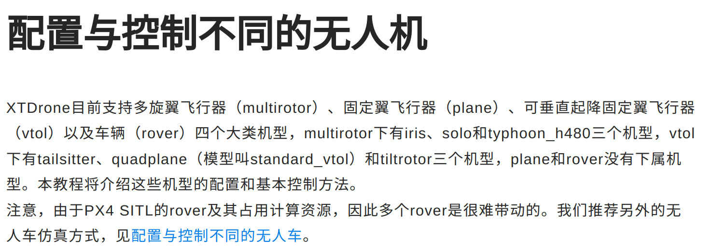

## XTDrone注意事项

#### 一、XTDrone架构

**版本：Gazebo 11 + PX4 1.13**

**XTDrone单机器人架构：**


**XTDrone多机器人架构：**



#### 二、XTDrone支持的机器人类型

1. 多旋翼无人机（multirotor）
   - iris
   - solo
   - typhoon_h480
2. 固定翼无人机（plane）
3. 可垂直起降固定翼无人机（vtol）
   - tailsitter
   - quadplane（standard_vtol）
   - tiltrotor
4. 车辆（rover）：非常占用计算资源



#### 三、传感器配置&位姿真值

- 必备传感器（来自于PX4的状态估计需求）：加速度计、陀螺仪、磁罗盘、气压计、 GPS（mavlink通信）
- 可添加：单目/双目相机、深度相机与2D/3D激光雷达
- typhoon_h480特殊：自带了云台和相机

启动获取位姿真值的脚本：

```
cd ~/XTDrone/sensing/pose_ground_truth/
python get_local_pose.py iris 1 
```

#### 四、坐标关系

- /iris_0/mavros/global_position/global   为base_link 经度维度高度
- /iris_0/mavros/global_position/gp_origin   为earth坐标系  不清楚具体含义
- /iris_0/mavros/local_position/pose   为map坐标系   Gazebo物理引擎坐标真值
- **详细见多无人机编队**，**其中有真值代码 **    **gazebo/set_model_states**
- 直接跑章节 **加速仿真、瞬移飞机与大规模集群**  内容

#### 十、ROS使用注意事项

1.编译单个包

```
catkin_make -DCATKIN_WHITELIST_PACKAGES="package1;package2"
```

